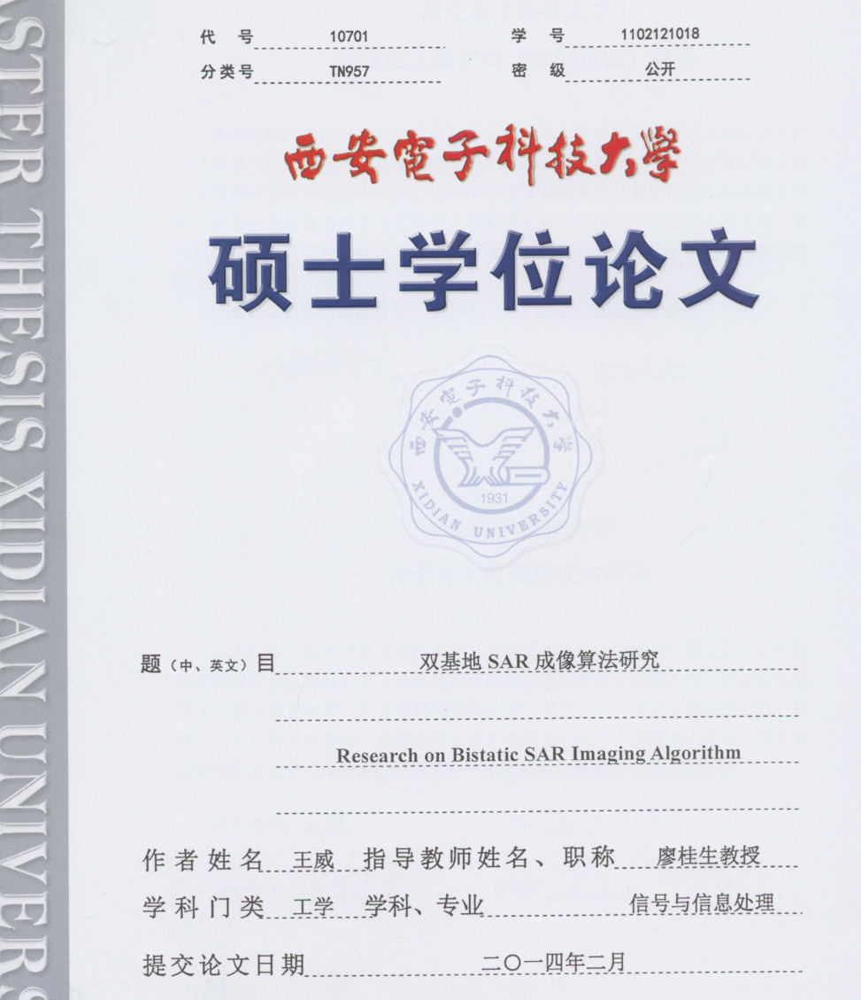
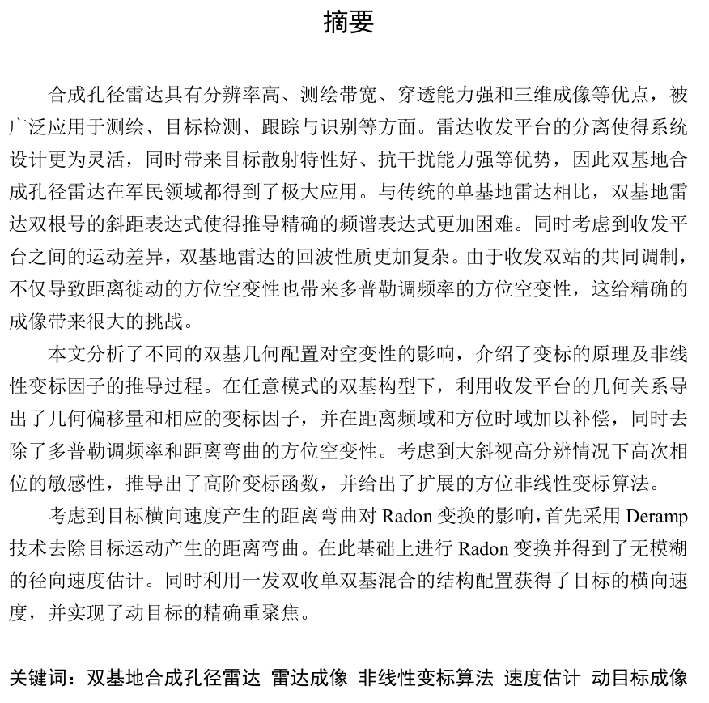
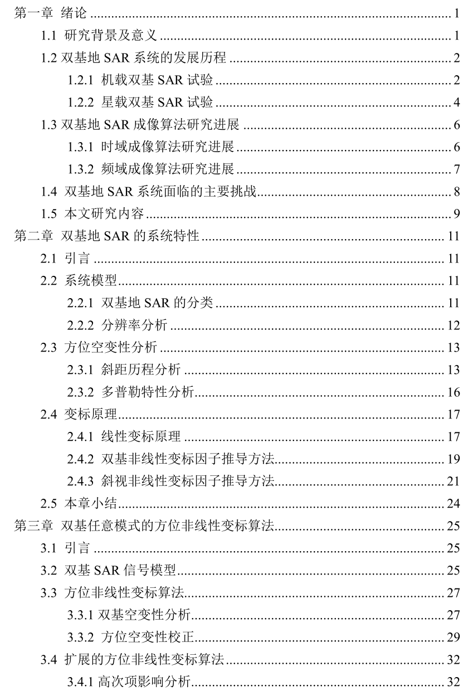
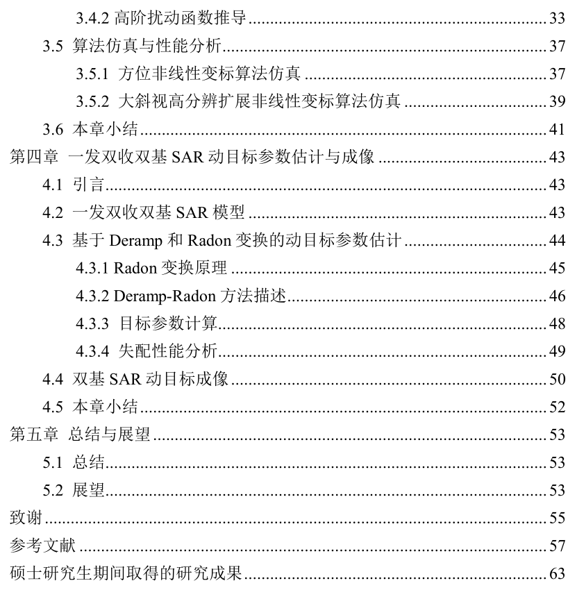
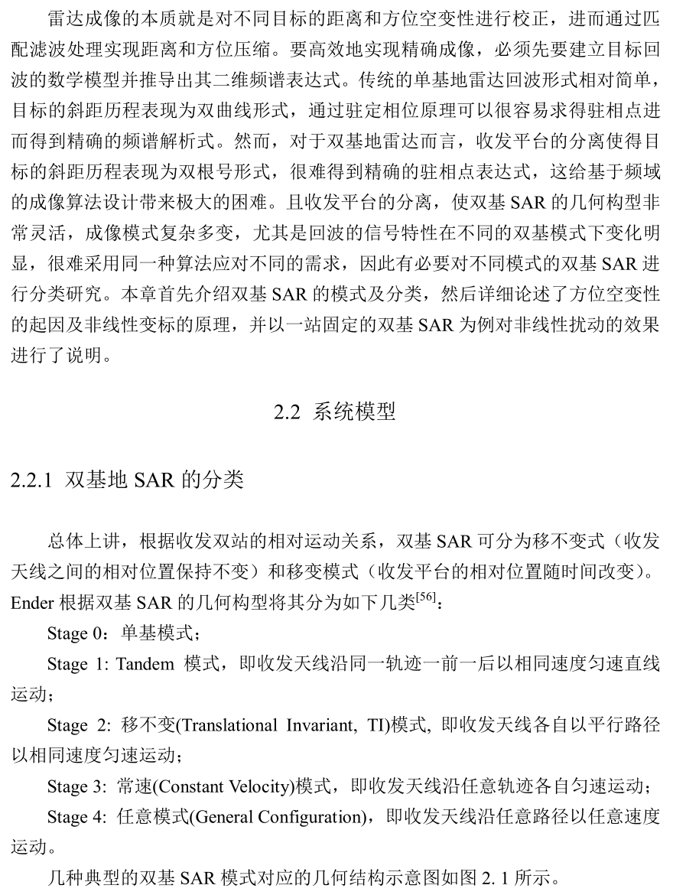
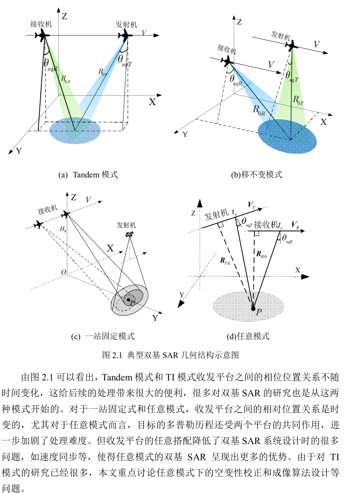
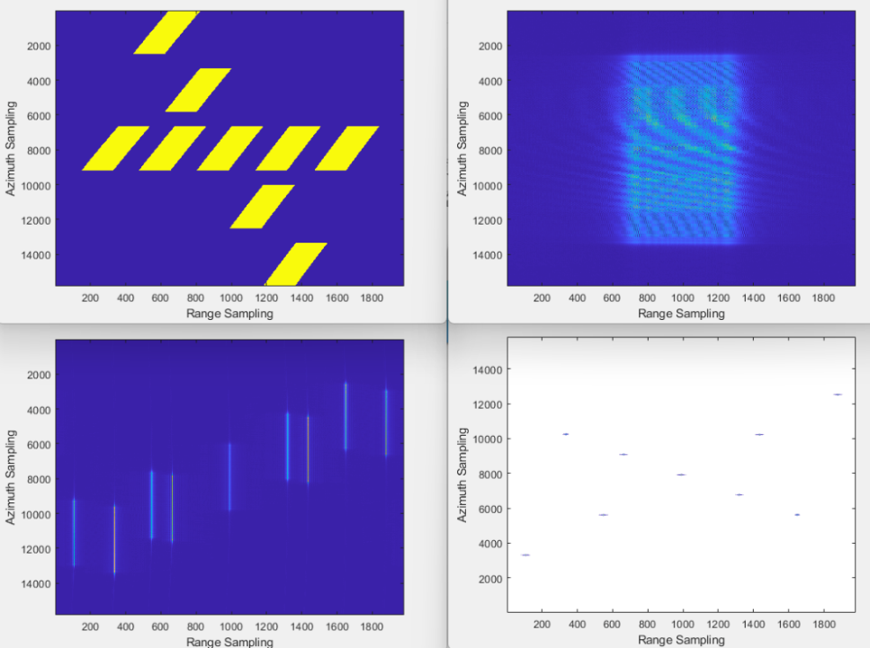

# [SAR Imaging] Research on the Algorithm of Dual-Base SAR Imaging [with MATLAB Code]

Dual-base SAR model
MATLABCode simulation%%\nclc;close all;clear all;\n% Signal parameter setting\nFc=10e9;\nC=3e8;\nlambda=C/Fc;j=sqrt(-1);\n​\n​\n% Define the yaw angle as the angle between the flight path and the X-axis, indicating the direction of platform movement\nyawangle_R=5/180*pi;  % Receiver Yaw\nyawangle_T=35/180*pi;   % Transmitter Yaw Angle\n​\nbeamwidth_R=1.0/180*pi; % Received Beamwidth\nbeamwidth_T=10/180*pi; %Emitted beam width\n​\nX0_R=-15e3;       % Define the receiver position as ta=0\nY0_R=-20e3;\nH_R=10e3;\nV_R=150;       % Receiver Speed\nRgrmin=sqrt(X0_R^2+Y0_R^2)*sin(yawangle_R+atan(Y0_R/X0_R)); % The minimum ground distance from the receiver to the scene center, not a projection in the xy plane but rather along the flight direction.\nXR_shift=sqrt(X0_R^2+Y0_R^2)*cos(yawangle_R+atan(Y0_R/X0_R)); % Horizontal offset\nRRB=sqrt(H_R^2+Rgrmin^2);        % Vertical distance\nRR0=sqrt(RRB^2+XR_shift^2);     % Minimum Received Distance\ntheta_sqR=atan(XR_shift/RRB);  % Beam Angle of View\ndisp('Received beam angular view');\ndisp(theta_sqR*180/pi);\n​\n​\nLar=RR0*beamwidth_R;            % Synthetic Aperture Length\nTs=Lar/V_R;                     % Synthetic Aperture Time\n​\n​\nX0_T=-20e3;      % Define the transmitter position, ta=0\nY0_T=-20e3;\nH_T=15e3;     \nV_T=200;     % Emission platform speed\nRgtmin=sqrt(X0_T^2+Y0_T^2)*sin(yawangle_T+atan(Y0_T/X0_T));\nXT_shift=sqrt(X0_T^2+Y0_T^2)*cos(yawangle_T+atan(Y0_T/X0_T));\nRTB=sqrt(H_T^2+Rgtmin^2);   % Vertical distance\nRT0=sqrt(RTB^2+XT_shift^2); %Minimum Launch Distance\ntheta_sqT=atan(XT_shift/RTB);% oblique view\n% theta_sqT=pi/2-theta_sqT;\ndisp('Transmitted beam angular view');\ndisp(theta_sqT*180/pi);\n​\nPRF=0.8e3;                   % Pulse Reprtition Frequency\nPRT=1/PRF;\n​\nXswath=2500;    % Scene Azimuth Width\nYswath=1600;    % Scene distance to width\n​\nXc=0;        % Set the scene center coordinates\nYc=0; \n​\nNa=fix((Lar+Xswath)/V_R*PRF);  % Number of azimuth sampling points\nNslow=Na;\ntslow=linspace(-Na/2*PRT,Na/2*PRT,Na);  % Positional slow time series\n​\nReceiver_position_x=X0_R+V_R*tslow*cos(yawangle_R);      % Receiver instantaneous coordinates\nReceiver_position_y=Y0_R-V_R*tslow*sin(yawangle_R);\nTransmitter_position_x=X0_T+V_T*tslow*cos(yawangle_T);   %Transmitter instantaneous coordinates\nTransmitter_position_y=Y0_T-V_T*tslow*sin(yawangle_T);\n​\nTr=1e-6;                           % Pulse width 2us\nBr=60e6;                         % Frequency Bandwidth 50MHz\nKr=Br/Tr;                         % Frequency adjustment\nFsr=3*Br;                      % Sampling rate\ndt=1/Fsr;                          % Sampling interval\n​\nNtarget=9;                            % Set the target count.\n% ***Target Attributes: format [x, y, z, reflectivity]*******\nPtarget=[\n    \nXc,                      Yc,                   0,1;            % position of targets    \nXc,              Yc+Yswath/2,          0,1;\nXc,              Yc-Yswath/2,           0,1\n​\n​\n​\nXc+Xswath/2,     Yc,                  0,1;\nXc-Xswath/2,     Yc,                  0,1;\n​\nXc+Xswath/4,     Yc,                  0,1;\nXc-Xswath/4,     Yc,                  0,1;\n​\nXc,              Yc+Yswath/4,          0,1;\nXc,              Yc-Yswath/4,           0,1\n​\n​\nXc,              Yc+Yswath/4,          0,1;\nXc,              Yc-Yswath/4,           0,1\n];\n​\n​\nRRmin=sqrt(H_R^2+(XR_shift)^2+(Y0_R+Yswath/2)^2);     % Receive the nearest distance\nRRmax=sqrt(H_R^2+(XR_shift)^2+(Y0_R-Yswath/2)^2);     % Receive maximum distance\n​\nRTmin=sqrt(H_T^2+(XT_shift)^2+(Y0_T+Yswath/2)^2);    % Launch the nearest distance\nRTmax=sqrt(H_T^2+(XT_shift)^2+(Y0_T-Yswath/2)^2);    %Maximum range of launch\n​\n​\n​\nRbi0=RR0+RT0;\nRbimax=Rbi0+1500;\nRbimin=Rbi0-1500;\n​\n% Rbimax=RRmax+RTmax;\n% Rbimin=RRmin+RTmin;\n​\nNfast=ceil((Rbimax-Rbimin)/C/dt+Tr/dt);                % Fast time sampling points\ntfast=linspace((Rbimin)/C-Tr/2,(Rbimax)/C+Tr/2,Nfast); % Fast time series\n​\n​\ngr=Y0_T+linspace(Yswath/2,-Yswath/2,Nfast);    % Distance to door division\nekecilong_T=asin(H_T/RT0);  %Emitted Beam Angle of Touching Ground\nekecilong_R=asin(H_R/RR0);  % Received Beam Ground Angle\nyT=gr;%.*cos(ekecilong_T);\nyR=gr;%.*cos(ekecilong_R);\n​\nRgt=sqrt(X0_T^2+yT.^2).*sin(yawangle_T+atan(yT./X0_T));\nXT_shift=sqrt(X0_T^2+yT.^2).*cos(yawangle_T+atan(yT./X0_T));\nRTBb=sqrt(H_T^2+Rgt.^2);   % Vertical distance\nRT1=sqrt(RTBb.^2+XT_shift.^2); %Minimum Launch Distance\nRT00=ones(Nslow,1)*RT1;\n​\nRgr=sqrt(X0_R^2+yR.^2).*sin(yawangle_R+atan(yR./X0_R)); % Minimum ground distance from the receiver to the scene center\nXR_shift=sqrt(X0_R^2+yR.^2).*cos(yawangle_R+atan(yR./X0_R)); % Horizontal offset\nRRBb=sqrt(H_R^2+Rgr.^2);        % Vertical distance\nRR1=sqrt(RRBb.^2+XR_shift.^2);  % Minimum Received Distance;\nRR00=ones(Nslow,1)*RR1;\n​\n% gr1=linspace(-Yswath/2,Yswath/2,Nfast);\n% \n% Rgt=Rgtmin+gr1.*cos(ekecilong_T);\n% RTBb=sqrt(H_T^2+Rgt.^2);   % Vertical distance\n% RT1=sqrt(RTBb.^2+XT_shift^2); % Minimum Emission Distance\n% RT00=ones(Nslow,1)*RT1;\n% \n% Rgr = Rgrmin + gr1.*cos(ekecilong_R); % Receiver to scene center minimum distance\n% RRBb=sqrt(H_R^2+Rgr.^2);        % Vertical distance\n% RR1=sqrt(RRBb.^2+XR_shift^2);     % Minimum Received Distance;\n% RR00=ones(Nslow,1)*RR1;\n​\n%% Generate the raw signal data  Generate the data matrix needed for processing.\n%  \nT=Ptarget;                                           % Target location\nRaw_echo=zeros(Nslow,Nfast);          % Initialize echo data matrix\nh = waitbar(0,'Echo Generating');         % Generate progress bar\nfor target_num=1:Ntarget\n       sigma=T(target_num,4);                                 % Extract the target's RCS\n        RX=Receiver_position_x-T(target_num,1);   % Relative displacement\n        RY=Receiver_position_y-T(target_num,2); \n        TX=Transmitter_position_x-T(target_num,1);\n        TY=Transmitter_position_y-T(target_num,2); \n        RR=sqrt(RX.^2+RY.^2+H_R^2);                % Calculation of oblique distance\n        RT=sqrt(TX.^2+TY.^2+H_T^2);\n        Rbi=RR+RT;\n        tau=Rbi/C;                                                      % Calculate the delay for each target\n        Dfast=ones(Nslow,1)*tfast-tau'*ones(1,Nfast);  %Calculate the fast time variable\n        phase=pi*Kr*Dfast.^2-(2*pi/lambda)*(Rbi'*ones(1,Nfast));\n        Raw_echo=Raw_echo+sigma*exp(j*phase).*(abs(Dfast)<Tr/2).*((abs(RX-X0_R)<Lar/2/cos(yawangle_R)).'*ones(1,Nfast));\n        waitbar(target_num/Ntarget);\nend\nclose(h);                           % Close progress bar indicator\n%================================================================\n%Backscatter test\\nfigure;colormap(gray);imagesc(real(Raw_echo));\ntitle('Original echo');\n% figure;imagesc(abs(ftx((Raw_echo))));    % 2-D Spectrum\n% xlabel('Range Sampling');\n% ylabel('Azimuth Sampling');\nfr=linspace(-Fsr/2,Fsr/2,Nfast);   % Range Frequency Variable\nFr=ones(Nslow,1)*fr;               % Expand to Matrix\nfa=linspace(-PRF/2,PRF/2,Nslow);   %Azimuth Frequency Variable\nFa=fa.'*ones(1,Nfast);             % Expand to Matrix\n​\nsig_frta=fty(Raw_echo);\n​\nk1=V_T*sin(theta_sqT)+V_R*sin(theta_sqR);   % Linear term coefficient\ndeltR_walk=-k1*tslow;                       % Distance moved\nHlrwc=exp(j*2*pi*deltR_walk.'*(fr+Fc)/C);  %LRWC\nHrc=exp(j*pi*Fr.^2/Kr);                     % Range Compression\nsig_frta1=sig_frta.*Hlrwc.*Hrc;\nfigure;imagesc(abs(ifty((sig_frta1))));    % \nxlabel('Range Sampling');\nylabel('Azimuth Sampling');\n\n        \n  

## Images

<!-- PAYMENT_BLOCK -->

## Get this dataset

- Payment link (Stripe): [Buy now](https://buy.stripe.com/3cs8yP7sY87d0vu9AB)
- Payment QR code: 

<!-- /PAYMENT_BLOCK -->
